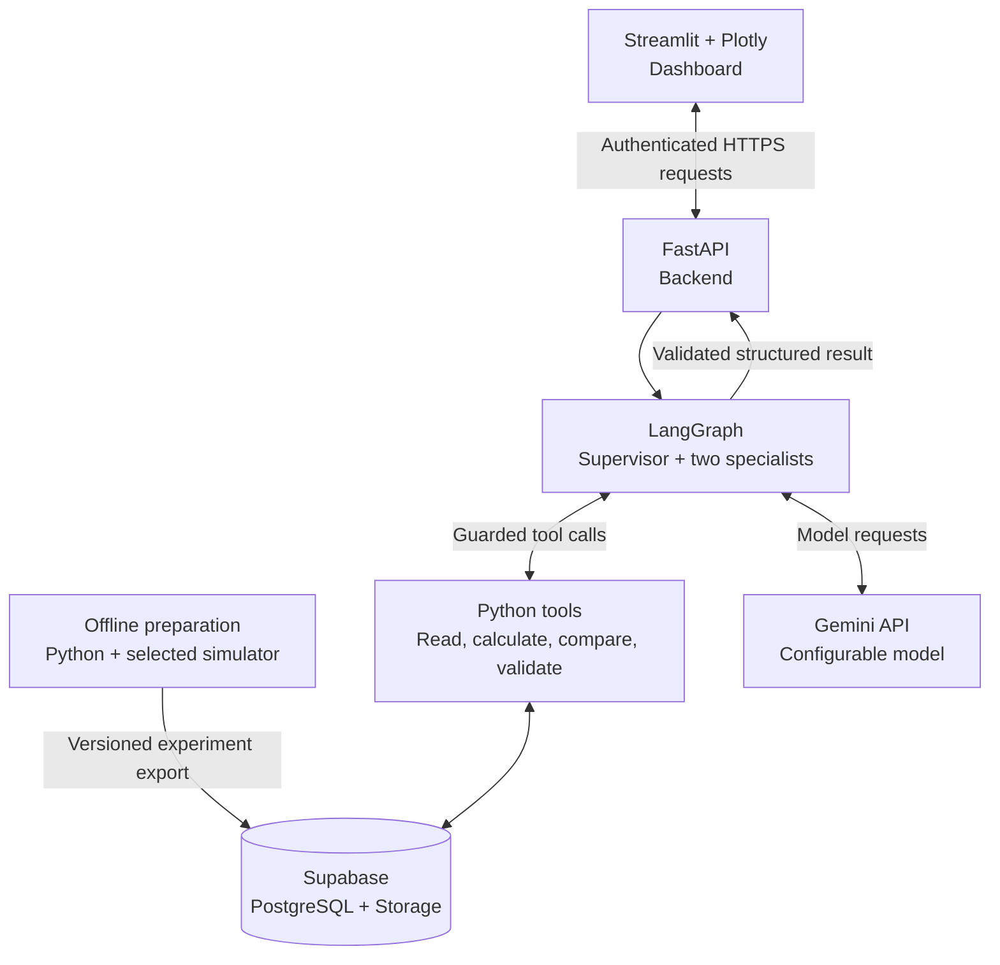
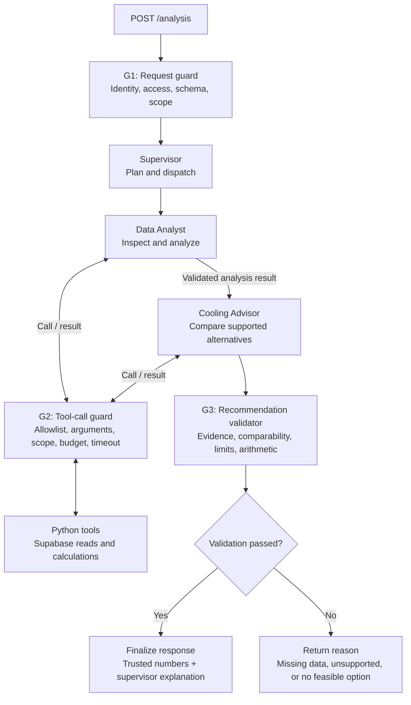

# Cooling Advisor Agent — Technical Architecture

Status: design specification; implementation has not started.

This document defines a Python-first advisory application that investigates data-center cooling performance and compares supported operating alternatives. It replaces the previous MPC-centered architecture. The original course proposal PDF remains a historical requirement reference; this redesign does not imply that its research objectives have already been met.

## 1. Scope and operating mode

The initial product supports one cooling zone, one supervisor agent, and two specialist agents. It uses precomputed simulation results or uploaded telemetry. An operator receives an evidence-backed comparison and decides whether to investigate or adopt a recommendation.

| Included in the MVP | Later extension |
|---|---|
| Inspect telemetry and data quality | Site-specific BMS connector |
| Calculate energy and compare a documented baseline | On-demand simulation worker |
| Retrieve and rank compatible precomputed experiments | Calibrated predictive models |
| Explain results with evidence references | Operational trial and savings verification |
| Enforce request, tool, and recommendation guardrails | Automated equipment control, subject to a separate design |
| Record case state, tool events, and validation outcomes | Larger-scale monitoring infrastructure |

The MVP has no RAG, vector database, document-retrieval pipeline, or knowledge graph. Skills are procedural agent instructions, not a knowledge base. Equipment limits are versioned application configuration, not values invented by an LLM.

## 2. Technology and deployment

| Component | Technology | Responsibility | Initial deployment |
|---|---|---|---|
| Dashboard | Streamlit + Plotly | Case creation, charts, comparisons, and monitoring views | Streamlit Community Cloud |
| Backend | FastAPI + Pydantic | Authentication, authorization, input/output contracts, and orchestration | Render web service |
| Agent workflow | LangGraph for Python | Supervisor routing, specialist execution, and termination paths | Backend process |
| Language model | Configurable Gemini API client | Tool selection and explanations | External API |
| Analysis | pandas + NumPy | Data-quality checks, energy integration, and baseline comparison | Backend process |
| Database | Supabase PostgreSQL via `supabase-py` | Telemetry, experiments, cases, and structured events | Supabase |
| File storage | Supabase Storage | Source CSV/Parquet files and larger result artifacts | Supabase |
| Offline simulation | Simulator-specific Python environment | Produce versioned, repeatable experiment results | Developer machine initially |
| Monitoring | Python structured logging + Supabase + Streamlit | Operational events, run history, and guardrail outcomes | Backend and dashboard |

Use the Python version and native dependencies supported by the selected simulator; do not assume the web service and simulator can share one environment. Pin tested dependencies when implementation starts.

Free service tiers are a demo deployment option, subject to their current quotas, availability, sleep behavior, and terms. They are not an always-on BMS monitoring service. Check current plan terms before deployment; no paid subscription or hosting account is configured by this document.



## 3. Data and simulator boundary

### 3.1 Data sources

- **Simulation experiments:** export input conditions, settings, time-series outputs, and measured-within-simulation energy values from reproducible runs.
- **Public measured datasets:** import selected telemetry for exploratory analysis. Dataset provenance and equipment scope must be explicit.
- **Site telemetry, later:** ingest authorized exports or a read-only BMS integration after establishing tag mappings, units, timestamps, and equipment scope.

Store `source_kind` as `simulated` or `measured` on every dataset and result. A measured dataset and a simulation are separate evidence sources; sharing a facility name does not make them interchangeable.

### 3.2 Simulator selection

SustainDC (`HewlettPackard/dc-rl`) is the initial air/HVAC simulator candidate inherited from the existing project. Sustain-LC (`HewlettPackard/sustain-lc`) is a separate candidate for liquid cooling. Select and validate one before generating the MVP experiment catalog. The adapters, observations, and actions are different.

The archived project notes report unresolved issues for one older SustainDC configuration: a weak cooling-energy trade-off, differences in IT energy, temperature observability, and potentially incomplete power accounting. These are historical observations, not verified claims about the current upstream version. Reproduce or reject them using a pinned commit and recorded configuration.

**Feasibility gate:** compare fixed settings and an appropriate rule-based baseline under identical workload, weather, initial state, duration, configuration, and seeds. Check the modeled temperature variables and energy boundary. If one setting dominates all alternatives, report that result; do not manufacture an optimization benefit or modify limits solely to make the advisor appear useful.

### 3.3 Precomputed experiment contract

Each experiment must identify:

```text
experiment_id, scenario_id, initial_snapshot_id
source_kind, simulator_name, simulator_commit, config_hash
workload_trace_id, weather_trace_id, seed_manifest
action_history_or_candidate_plan, setting_units
evaluation_start, evaluation_end, timestep_definition
temperature_metric_definition, temperature_observability
energy_boundary, baseline_experiment_id
policy_version, artifact_reference, artifact_hash
```

Compare only experiments with matching relevant conditions and a common evaluation horizon and energy boundary. Apply tolerances only when explicitly defined and validated. Missing matches return `not_supported`; the agent must not present a nearby experiment as an exact simulation of a new request.

For average power samples, energy is `sum(power_kW * interval_hours)` over valid intervals. For instantaneous samples, use a documented integration rule. Handle irregular timestamps, gaps, and cumulative-meter resets explicitly. A temperature average cannot establish a maximum-rack temperature constraint. An unavailable required metric makes that constraint unverifiable.

## 4. AI agent architecture

The supervisor communicates with the user. Specialists return structured results to the supervisor and have narrowly assigned tools. All three can use the same LLM model through a shared client abstraction; they differ in role instructions, skills, and tool access.

| Agent | Responsibility | Allowed capabilities | Output |
|---|---|---|---|
| Supervisor | Interpret the request, choose the next task, coordinate specialists, and explain validated results | Invoke the two specialists and inspect case status | Structured task plan and explanation tied to validated evidence |
| Data Analyst | Inspect data quality, summarize current conditions, and compare a compatible baseline | `read_telemetry`, `inspect_data_quality`, `compute_baseline` | `DataAnalysisResult` |
| Cooling Advisor | Retrieve supported alternatives and compare their recorded outcomes | `lookup_experiments`, `compare_candidates` | `CandidateResults` with evidence IDs |

### 4.1 Shared state and trusted context

```text
RunContext (server-created; read-only to model-generated content)
  case_id, user_id, authorized_zone_ids, policy_version
  deadline, llm_call_budget, tool_call_budget

AnalysisState (validated updates across graph nodes)
  request, plan, data_analysis, candidate_results
  validation_result, response, evidence_ids, execution_status
```

Tool-usage reservation, elapsed-time checks, and authorization are enforced by code using the trusted context. Shared quotas cover the supervisor and both specialists, including retries. Persist case state explicitly; an in-memory LangGraph state or Streamlit session is not restart recovery by itself.

### 4.2 Execution flow and guardrail placement



This is the full-recommendation path. A current-state question can terminate after Data Analyst execution and evidence validation. The supervisor remains the coordinator when moving between specialist nodes; the diagram abbreviates its dispatch transitions.

1. Validate the request and create trusted context.
2. The supervisor determines whether analysis alone or a recommendation is required.
3. The Data Analyst retrieves data through guarded tools and produces a quality report and calculated facts.
4. If data is sufficient and alternatives are requested, the Cooling Advisor retrieves comparable experiments and proposes candidate IDs.
5. The Python validator independently retrieves referenced results, checks constraints, and recomputes the comparison.
6. The supervisor writes an explanation. The response builder attaches the validated settings, numbers, units, and evidence references.
7. Validate the final response schema and its references before returning it. Numerical facts shown in tables and charts come from the validated result, not newly generated prose. Reject or repair an explanation that contradicts those facts within the configured retry budget.

Insufficient evidence is a valid terminal outcome. No node may silently replace missing inputs with invented observations or claim that a simulated result is a realized saving.

## 5. Guardrails

| Guard | Implementation boundary | Required checks | Failure behavior |
|---|---|---|---|
| G1 | FastAPI dependencies + Pydantic request model | Verified user identity; zone access; valid time range; request-size and request-rate limits | Reject before invoking the graph |
| G2 | A common wrapper around every registered tool | Tool allowlist; input schema; server-enforced data scope; bounded queries; shared budget; per-call and overall deadlines; output schema | Do not execute a rejected call; record a typed error |
| G3 | Deterministic Python validator and final response assembly | Evidence existence and provenance; compatible scenario/horizon; temperature observability; configured operating limits; energy scope; arithmetic; output consistency | Return a reasoned non-recommendation or request bounded re-analysis |

- Tool names are mapped to registered Python functions. Model-generated SQL, shell commands, or arbitrary URLs are not execution interfaces.
- Inputs, tool responses, and model outputs have explicit schemas. Text in telemetry labels or uploaded data cannot grant tool privileges or change policy.
- Permissions, hard limits, and equipment constraints come from versioned configuration approved for the scenario/site. Do not hardcode one temperature limit for all equipment or transfer air-inlet limits to liquid-coolant variables.
- Enforce deadlines and cancellation around model and tool calls, plus a graph-step limit. These are distinct controls; a graph-step limit alone does not cap API calls or elapsed time.
- Reserve shared usage budgets atomically if execution becomes concurrent. A failed call or retry still consumes the relevant budget.
- Use server-validated identity and scope. Protect Supabase tables and storage with appropriate access policies; privileged service keys bypass normal RLS protections and therefore require explicit backend authorization.
- Store secrets only in server-side secret configuration. Redact tokens and sensitive telemetry from logs and model requests.
- The MVP has no actuator tool. Connecting a live BMS for reads does not authorize equipment writes. Any future control service needs fresh-state checks, equipment-specific interlocks, operator authorization, and rollback behavior in a separate implementation.

## 6. Initial skill specifications

Skills are procedural specifications used by the agents. They are not additional agents, and they do not require an embedding store or retrieval system.

| Skill | Owner | Input | Required procedure | Output / stop condition |
|---|---|---|---|---|
| Inspect Cooling Data | Data Analyst | Authorized zone, time range, dataset reference | Read bounded data; check timestamp meaning, units, coverage, and required fields | Quality report; stop if required evidence is unavailable |
| Analyze Cooling Performance | Data Analyst | Validated telemetry and baseline definition | Integrate energy; summarize defined temperature metrics; compare compatible windows | Facts and hypotheses kept separate; no causal claim from correlation alone |
| Evaluate Cooling Options | Cooling Advisor | Scenario, snapshot, baseline ID, horizon, and policy | Retrieve comparable runs; use Python comparisons; return candidate and evidence IDs | Candidate results or `not_supported` / `no_feasible_option` |
| Compose Recommendation | Supervisor | Validated findings and candidate selection | Explain the recommendation, trade-offs, provenance, and limitations | Schema-valid explanation tied to approved result fields |

Each skill specification should declare its name/version, trigger, input/output schema, allowed tools, ordered procedure, success criteria, and stop conditions. Behavior-critical checks must also be enforced in Python.

## 7. API and result contracts

Proposed endpoints:

```text
POST /analysis               Create and execute a bounded analysis case
GET  /cases/{case_id}        Read authorized case status and result
GET  /cases/{case_id}/events Read authorized monitoring events
GET  /health                Lightweight process-health response
```

The MVP uses bounded request execution. A response includes a `case_id`. A timeout is recorded as a terminal failure; retries use an idempotency key to avoid duplicate case writes. An optional external worker and durable job queue require a later design. A `job_id` or an in-process background task alone does not provide durable execution on a sleeping/restarting free host.

```text
AnalysisResponse
  case_id
  status: completed | insufficient_data | not_supported |
          no_feasible_option | budget_exceeded | failed
  source_kind, scenario_id, policy_version
  validated_facts, baseline, selected_candidate
  evidence_ids, explanation, limitations
```

A successful analysis can conclude that the existing setting is best or that no supported change improves energy use. Such outcomes must remain visible rather than being rewritten as a positive recommendation.

## 8. Supabase data model

| Table / store | Purpose |
|---|---|
| `datasets` | Provenance, schema version, units, source kind, and storage references |
| `telemetry` | Timestamped, scoped metric samples and quality flags; import only needed subsets |
| `scenarios` | Configuration, initial state, traces, duration, and seed references |
| `experiment_runs` | Candidate settings, baseline links, outputs, manifest, and metric definitions |
| `policies` | Versioned limits, allowed ranges, comparison rules, and budgets |
| `cases` | Owner/scope, lifecycle status, validated state, and final response |
| `agent_events` | Step-level execution, model usage, tool calls, and errors |
| `guardrail_events` | Guard name, decision, reason codes, and evidence references |
| Storage buckets | Larger CSV/Parquet artifacts; database rows retain hashes and references |

Use stable IDs and explicit foreign keys. Keep experiment artifacts immutable once referenced by a completed case. Limit log retention and avoid importing entire large public datasets into a small free database.

## 9. Monitoring and evaluation

Use one `case_id` and `trace_id` across the API, supervisor, specialists, and tools. Add `step_id` and `parent_step_id` to reconstruct parent/child execution. Events record timestamps, duration, actor/tool name, status, model/skill/policy versions, usage when available, evidence IDs, and typed errors. Record observable actions and outcomes rather than hidden model reasoning.

Streamlit includes a monitoring page for failed cases, latency, model/tool usage, missing-data cases, guardrail rejections, and case drill-down. Python console logging remains useful if the monitoring database itself is unavailable. Report incomplete audit persistence explicitly; do not leave a case marked successfully persisted when storage failed.

Evaluate three distinct layers:

1. **Tools and guardrails:** energy arithmetic, authorization, units, unsupported scenarios, insufficient temperature observability, incompatible experiments, timeouts, and retries.
2. **Agent behavior:** correct tool selection, evidence support, completion rate, abstention on missing evidence, latency, and usage. Compare with direct Python selection using the same data and rules.
3. **Cooling outcomes:** evaluate selected settings with the simulator or a controlled site trial. Report total energy, cooling energy, temperature-constraint behavior, and scope separately. Precomputed results demonstrate only the scenarios actually evaluated.

A savings target is an experimental hypothesis, not an architectural guarantee. Baseline and candidate runs must share relevant conditions. Any later learned surrogate must be tested on held-out cases and cannot grade its own proposed control policy without independent evaluation.

## 10. Proposed code layout

This is a future implementation layout, not a claim that these files already exist.

```text
project/
├── architecture.md
├── archive/                         # Recoverable pre-redesign documents
├── Midterm Project /                # Original proposal PDF, unchanged
├── dashboard/
│   └── app.py                       # Streamlit user and monitoring views
├── backend/
│   └── app/
│       ├── main.py                  # FastAPI endpoints and G1
│       ├── schemas.py               # Pydantic contracts
│       ├── auth.py                  # Identity and scope enforcement
│       ├── agents/
│       │   ├── graph.py             # State, routing, and termination
│       │   ├── supervisor.py
│       │   ├── data_analyst.py
│       │   └── cooling_advisor.py
│       ├── skills/                  # English procedural specifications
│       ├── tools/
│       │   ├── gateway.py           # G2 wrapper and tool registry
│       │   ├── telemetry.py
│       │   ├── baseline.py
│       │   └── experiments.py
│       ├── guardrails/
│       │   ├── context.py           # Trusted run scope and budgets
│       │   └── recommendation.py    # G3 and response consistency
│       ├── repositories/            # Scoped Supabase access
│       └── monitoring/              # Structured events and persistence
├── offline/
│   ├── simulator_adapter.py         # One verified simulator initially
│   ├── generate_experiments.py
│   └── export_results.py
├── configs/                         # Versioned policies and scenarios
├── supabase/
│   └── migrations/                  # Tables and access policies
└── tests/                           # Meaningful tool, guardrail, and workflow checks
```

## 11. Implementation order

1. Verify the selected simulator and energy/temperature definitions. Record the feasibility-gate outcome before claiming an optimization opportunity.
2. Export one scenario and compatible alternatives; build the Supabase schema and scoped import path.
3. Implement deterministic data-quality checks, energy calculations, comparison, and G1/G2/G3. Prove the result without an LLM first.
4. Add the Data Analyst, then the Cooling Advisor, then supervisor orchestration using validated contracts.
5. Add Streamlit case views and monitoring. Verify interrupted requests, repeat submissions, and recovery behavior.
6. Deploy a limited demo with precomputed results. Check current hosting and model-tier terms and test native dependencies separately before considering live simulation.

## 12. References and design status

- SustainDC: https://github.com/HewlettPackard/dc-rl
- Sustain-LC: https://github.com/HewlettPackard/sustain-lc
- LangGraph: https://docs.langchain.com/oss/python/langgraph/graph-api
- Supervisor/subagents: https://docs.langchain.com/oss/python/langchain/multi-agent/subagents
- FastAPI: https://fastapi.tiangolo.com/
- Supabase Python: https://supabase.com/docs/reference/python/introduction
- Supabase access policies: https://supabase.com/docs/guides/database/postgres/row-level-security
- Streamlit hosting: https://docs.streamlit.io/deploy/streamlit-community-cloud
- Render deployment constraints: https://render.com/docs/free

The existing `knowledge/` directory and previous `architecture.md` are preserved together in [`pre-agent-redesign-2026-10-31.tar.gz`](archive/pre-agent-redesign-2026-10-31.tar.gz), a verified archive under `archive/`. They are historical notes, not the active runtime architecture. No application code, deployment, equipment connection, or operational approval is created by this document.
