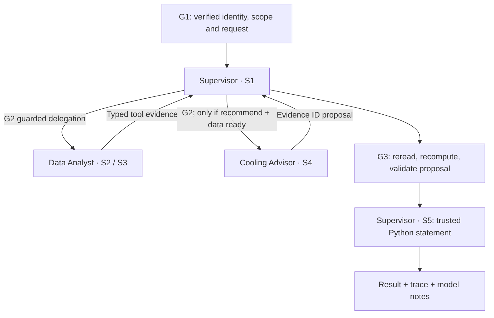

# Agents and Skills

[Architecture index](../../architecture.md) · [Runtime details](runtime.md)

| Role | Skills | Tools |
|---|---|---|
| Supervisor (parent) | S1 Plan, S5 Compose | call_data_analyst, call_cooling_advisor, finish_case |
| Data Analyst (child) | S2 Inspect, S3 Analyze | read_telemetry, inspect_data_quality, compute_baseline, finish_analysis |
| Cooling Advisor (child) | S4 Evaluate | lookup_experiments, compare_candidates, propose_option |

The runtime registry is `cooling_advisor/skills.py`; actual instructions are in `cooling_advisor/skill_specs/`. A skill is a versioned procedure, not a model or a permission grant. Loading instructions cannot expand the gateway allowlist.

Offline mode executes role procedures in graph nodes. Gemini mode uses a graph node containing bounded nested parent/child loops, separate histories, one configured model and manual function responses. The parent cannot finish until required children return. The final numerical explanation is deterministic; model notes are separate. No knowledge retrieval or vector database is present.
