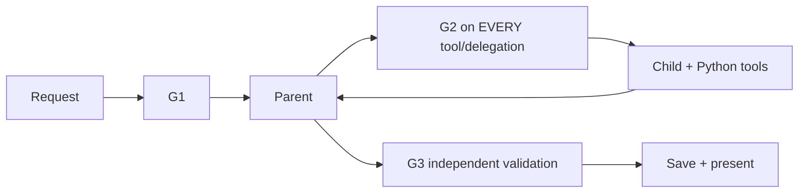

# Guardrails

[Architecture index](../../architecture.md)

| Guard | Execution point | Checks | Stops with |
|---|---|---|---|
| G1 | FastAPI before workspace operations; engine scope entry | Bearer token or verified Supabase user, approved zone membership, owner-scoped catalog, Pydantic request schema, bounded request body and operation rate | HTTP 401/403/413/422/429; no tool execution |
| G2 | Every role tool and parent delegation | Skill owner/tool allowlist, selected scenario scope, phase-available function schemas, shared tool/model budget and deadline | rejected tool / budget_exceeded / failed |
| G3 | After role execution, before selected result | Authoritative baseline reread; data quality; exact comparability; total energy integration; setpoint/inlet policy; feasible minimum; proposal matches evidence | insufficient_data / not_supported / no_feasible_option / failed |

Guards are Python checks, not another LLM that votes on a response. G3 checks bounded study evidence; it does not establish physical operational safety. There is no actuator path after human review. Provider explanations/notes are not trusted numerical evidence.

The simulator runs in a separate process with a 60-second hard timeout. Synchronous Python numeric tools check the deadline before/after execution. Model HTTP timeouts use remaining budget; there is no distributed cancellation or job service. Per-owner rate limits are process-local. These limits suit the local demo and require a distributed replacement for multiple workers.
