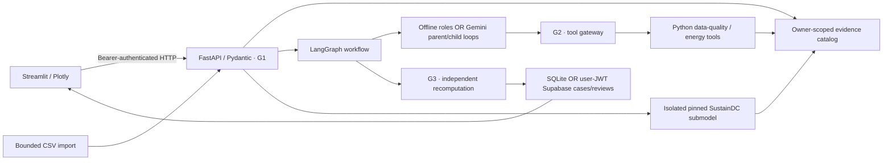

# System Overview

[Architecture index](../../architecture.md)

Simulation/import is a separate explicit user operation. Analysis agents use existing evidence and cannot start arbitrary programs, query arbitrary SQL or command equipment. Source provenance is stored separately from execution metadata (request, policy, model, skill hashes).

The local default is fully usable without external accounts. Optional Gemini/Supabase clients are implemented but await credentials for live validation. See [status](../prototype-status.md).
